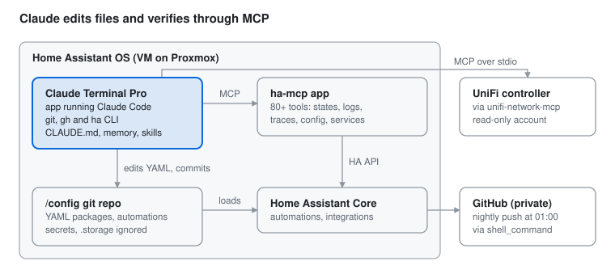
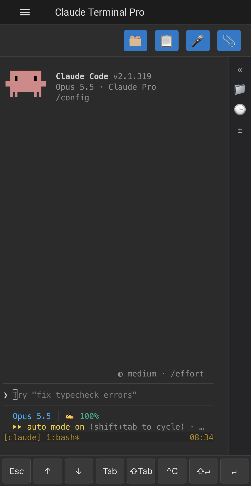
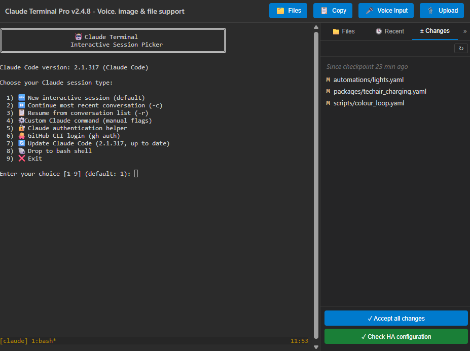


*Neil Sleightholm · 7 November 2026 · [Updates](#updates)*

[Claude Code](https://github.com/anthropics/claude-code), Anthropic's agentic coding CLI, runs as an app (formerly add-on) inside my Home Assistant install and works as a day-to-day admin assistant for a large setup (about 700 devices and 4,300 entities). It edits the live configuration, which is a git repo pushed to GitHub every night, and talks to Home Assistant and my network controller through MCP servers.

This write-up covers how the pieces fit together, how each one is set up, the guard-rails that keep it safe, and real examples of tasks it has done.

It's based on **Claude Terminal Pro 2.5.3**, with Claude Code 2.1.319, ha-mcp 9.1.1 and Home Assistant 2026.11.0. Later app releases may change menus and options.

The installation as of 31 October 2026:

| What | Count |
| --- | --- |
| Devices (enabled) | 699 |
| Entities (enabled, of 9,344 registered) | 4,268 |
| Integrations (config entries) | 110 (238) |
| HACS repositories installed | 52 |
| Apps | 21 |
| Zigbee devices (ZHA) | 38 |
| Z-Wave nodes | 39 |
| ESPHome device configs | 13 |
| Matter devices | 3 |
| Bluetooth devices (via adapters and proxies) | 8 (12) |
| Automations / scripts / scenes | 108 / 31 / 74 |
| Dashboards (views) | 10 (38) |
| Areas (floors) | 21 (4) |
| Recorder database (15-day retention) | about 1.5 GB |

## 1. The big picture

Claude Code works on the config files directly and uses MCP servers to see and verify what Home Assistant is actually doing.



Three layers work together:

1. **Files.** Claude Code works directly on `/config`, which is a git repo. It reads and edits YAML, runs `git`, and sees the full history.
2. **Runtime.** The ha-mcp server gives Claude live access to Home Assistant: entity states, history, logs, automation traces, service calls, dashboards and helpers.
3. **Guard-rails.** A project `CLAUDE.md`, persistent memory, custom skills and a permission allow-list keep Claude's behaviour consistent and safe between sessions.

## 2. Components

Three projects make up the core setup.

| Component | What it does | Repository |
| --- | --- | --- |
| Claude Code | Anthropic's agentic CLI. It reads and edits files, runs shell commands and calls MCP tools. Nothing to install separately: the Claude Terminal Pro app installs it and can update it on every start. You log in with a paid Claude plan or an Anthropic Console account. | [anthropics/claude-code](https://github.com/anthropics/claude-code) |
| Claude Terminal Pro (HA app) | Runs Claude Code in a web terminal in the HA sidebar (ingress). Adds persistent auth and packages, file and screenshot upload, and a Files sidebar for reviewing Claude's changes (section 3). | [esjavadex/claude-code-ha](https://github.com/esjavadex/claude-code-ha) |
| ha-mcp (HA app) | A Model Context Protocol server for Home Assistant, with 80+ tools: Claude's live view of states, logs, traces and config (section 4) | [homeassistant-ai/ha-mcp](https://github.com/homeassistant-ai/ha-mcp) |

**Optional additions.** Two more that I use, but you don't need them to get started:

| Component | What it does | Repository |
| --- | --- | --- |
| unifi-network-mcp | An MCP server for the UniFi Network controller: clients, devices, firewall, stats (section 4) | [sirkirby/unifi-mcp](https://github.com/sirkirby/unifi-mcp) (PyPI: `unifi-network-mcp`) |
| Spook (HA integration + Claude Code plugin) | A custom integration that finds "ghosts" (references to things that no longer exist) and adds 100+ extra actions. Its Claude Code plugin is a skill that teaches Claude how to use them and fix the repairs it raises. See [Using Spook with AI agents](https://github.com/frenck/spook#using-spook-with-ai-agents); install steps in section 5. | [frenck/spook](https://github.com/frenck/spook) |

## 3. The Claude Terminal Pro app

The app is where I actually work with Claude: how it's set up, the settings I use, and the features I rely on day to day.


*The app in a desktop browser (2.5.3): asked "is HA ok", Claude checks the system through ha-mcp and summarises its health and recent warnings. The status line is under the prompt.*

### Installing

**Requirements:** a paid Claude plan (Pro, Max, Team or Enterprise), or an Anthropic Console account with API billing (per token). Claude Code isn't included in the free plan. I'm on the Pro plan and log in through the browser. I use it a lot and have never needed to buy extra usage credit; keeping to one task per session (section 8) helps.

1. In Home Assistant, open the app store (Settings → Apps), then ⋮ → **Repositories**, and add `https://github.com/esjavadex/claude-code-ha`.
2. Install **Claude Terminal Pro** and start it.
3. Open it from the sidebar and log in to Claude when asked. The login link also appears as a Home Assistant notification, including in the Companion app. With a subscription, no API key is needed.

The [install section of the README](https://github.com/ESJavadex/claude-code-ha#install) has a one-click button that adds the repository for you.

### Setup notes

- Claude Terminal Pro is a fork of the original [Claude Terminal](https://github.com/heytcass/home-assistant-addons) app (heytcass/home-assistant-addons), which is still developed separately. Everything in this write-up is based on the Pro fork. Full disclosure: I contribute to Claude Terminal Pro.
- The app keeps its state in its `/data` volume: Claude's login, `~/.claude` (memory, settings, history) and packages installed with its `persist-install` helper. All of it survives app restarts and upgrades.
- Its built-in `persistent-package-manager` skill means that when Claude needs a tool (`jq`, `uv`, a Python library), it installs it in a way that survives container rebuilds, instead of a plain `apk add` or `pip install`.
- Watch backup size. Persisted packages, Python runtimes and caches all land in the app's backup. An early version bloated backups to more than 5 GB, and a later release fixed it.

### My app settings

I run the app with these options (Settings → Apps → Claude Terminal Pro → Configuration, *Edit in YAML*):

```yaml
auto_launch_claude: true
working_directory: ""                 # starts in /config
claude_code_oauth_token: ""           # log in through the browser instead
dangerously_skip_permissions: false
enable_remote_control: false
claude_extra_args: ""
tmux_mouse: false
use_persistent_claude: true
auto_update_claude_on_start: true
persistent_apk_packages:
  - openssh-client
persistent_pip_packages:
  - uv
init_commands: []
voice_stt_provider: ""                # voice input (new in 2.4.0), not set up yet
voice_language: ""
statusline:                           # the bar under Claude's prompt
  - model
  - context
  - duration
  - lines
  - usage
  - tokens
home_assistant_plugin: true           # bundled HA plugin, on by default
```

The ones I changed from the defaults, and why:

| Option | Default | Mine | Why |
| --- | --- | --- | --- |
| `use_persistent_claude` | `false` | `true` | Runs Claude Code from `/data/npm` instead of the copy baked into the image, so I'm not tied to the app's release cycle. It's left out of backups (about 240 MB) and reinstalled after a restore. |
| `auto_update_claude_on_start` | `false` | `true` | Updates that persistent copy on every app start, so restarting the app is all it takes to get the latest Claude Code |
| `persistent_apk_packages` | none | `openssh-client` | `git push` over SSH to GitHub (section 6) |
| `persistent_pip_packages` | none | `uv` | Provides `uvx` for the unifi-network MCP server (section 4) |

The rest are deliberately left at the defaults:

- **`dangerously_skip_permissions: false`.** Claude still checks before risky actions, even in auto mode (section 5). On a box that controls locks and the alarm, I want that prompt.
- **`claude_code_oauth_token` empty.** I log in through the browser with my Claude account, which Remote Control would also need (see below).
- **Direct ports 7680/7681 closed** (the app's Network settings). The terminal is reached only through the HA sidebar (ingress), which requires an HA login. The direct ports serve a root shell with no login of their own.

**Claude Code's own settings.** One setting outside the app's options: on first start Claude Code offered its fullscreen renderer, and I said yes. It's the flicker-free renderer that takes over the whole terminal and keeps its own scrollback. The choice is saved in `~/.claude/settings.json`, which lives in the app's `/data`, so it survives restarts and updates:

```json
{
  "tui": "fullscreen"
}
```

`/tui fullscreen` and `/tui default` switch between it and the classic renderer at any time.

### Using the terminal day to day

The terminal is an HA sidebar panel, so it works anywhere Home Assistant does: a browser on a PC or Mac, or the HA Companion app on a phone or tablet, at home or over Tailscale. I use it from my phone quite often, e.g. to ask Claude why a light didn't come on while I'm standing in the room.

**Keys for a phone.** A phone keyboard has none of the keys Claude Code relies on, so on a touch screen the app shows a row of them above the on-screen keyboard: **Esc** (stop Claude or close a menu), **↑ ↓** (menus and earlier prompts), **Tab** (accept a suggested prompt), **⇧Tab** (switch to plan or auto-accept mode), **^C**, **⇧↵** (a new line without sending) and **↵**. Tapping one keeps the keyboard open. **^C** is guarded: two in a row would quit Claude, which is an easy double tap on a phone, so after one tap it shows *wait* for two seconds. Together with the terminal resizing to sit above the keyboard, this is what made the phone usable for real work rather than just checking in.

{: width="400"}

*On an iPhone: the toolbar, a new Claude session with the status line, and the row of keys at the bottom.*

**Paste screenshots and files.** Cmd/Ctrl+V pastes a screenshot straight into the terminal. Drag-and-drop and the 📎 Upload button take any file: images, PDFs, YAML, logs, CSV. Each upload is saved to `/data/uploads` and its path is typed at the prompt, ready for a question. On an iPhone or iPad, 📎 opens Photos or the Files app. A screenshot of a broken dashboard card or a Repairs message is often the quickest way to show Claude the problem.

**The Files sidebar: see what Claude changed.** The 🗂️ Files button opens a sidebar beside the terminal (full screen on a phone). It has four parts:

| Part | What it does |
| --- | --- |
| **± Changes** | Lists every file in `/config` changed since the last checkpoint, with a coloured line-by-line diff. **↩ Revert file** puts one file back; **✓ Accept all changes** saves a new checkpoint. |
| **Recent changes** | Files changed in the last hour, day or week, newest first |
| **Files** | A tree of `/config` to preview any file; **Insert path** types its path at the prompt |
| **✓ Check HA configuration** | Runs `ha core check` and shows the result |

The Changes tab is the one I use most. After Claude edits something, I can review the exact diff and undo a single file without going near git, and that works just as well on a phone. Because `/config` is already a git repo (section 6), the tab uses it directly: a checkpoint is a local commit, which the nightly job then pushes. The tab never lists, diffs or commits secrets, `.storage`, databases or keys, whatever `.gitignore` says.

**The status line.** Under Claude's prompt the app shows a status bar, set with the `statusline` option. Mine shows the model, how full the context is, the session's duration, lines changed, plan usage and tokens, which tells me when it's time to start a new session (section 8). It can also show home pieces such as alerts, repairs, backups, disk space, updates and unavailable entities, or any sensor you name.

**Remote Control (optional, not used here).** The app's *Enable Remote Control* option starts Claude with `--remote-control`. The same session then also appears as "Home Assistant" in the Claude mobile app and at [claude.ai/code](https://claude.ai/code), so you can drive it from another device without going through HA. It needs a normal claude.ai login (Pro, Max, Team or Enterprise), not an API key. If you turn it on, leave *Dangerously Skip Permissions* off: with both on, any device signed in to your Claude account can drive a root shell that runs tools without asking.

### The session picker

The session picker is the app's menu for starting Claude. With `auto_launch_claude: true` (my setting), opening the terminal starts a new Claude session straight away, and the picker appears when you exit Claude (`/exit`, or just `exit`, or Ctrl+C twice). With `auto_launch_claude: false`, the picker is the first thing you see. Whatever you start from it, you come back to the menu when it ends.

The app's docs now have a [Session Picker section](https://github.com/ESJavadex/claude-code-ha/blob/main/claude-terminal/DOCS.md#session-picker) describing these options.



*The session picker, with the ± Changes sidebar open (app 2.4.8).*

| Option | What it does | When I use it |
| --- | --- | --- |
| 1 New session | `claude` with the app's flags (Remote Control, extra args, skip-permissions if set). Enter on its own picks this. | Starting a new task |
| 2 Continue (`-c`) | Reopens the most recent conversation in `/config` with its full context | Picking up a conversation after I've exited Claude. Closing the browser tab or switching from PC to phone doesn't need it: the terminal runs in a tmux session that keeps going, and reopening the panel reattaches to it. |
| 3 Resume (`-r`) | Lists earlier conversations to choose from | Going back to an older task, e.g. a fix I want to follow up |
| 4 Custom command | Prompts for your own arguments, e.g. `--model …` or `-p "…"` for a one-off answer; the app's flags are still added | Occasional one-off runs |
| 5 Authentication helper | Alternative ways to log in when pasting the login code into the terminal fails: type it in, or read it from `/config/auth-code.txt` | First login, or after the login expires. The helper deletes `auth-code.txt` after use. |
| 6 GitHub CLI login | Runs `gh auth login` by browser or personal access token, so Claude can use `gh` for issues and PRs | Once; the login is kept in `/data` |
| 7 Update Claude Code | Installs the latest Claude Code into `/data/npm` and shows whether an update is available. Only shown with `use_persistent_claude: true`; otherwise the options below move up one number. | When the menu shows a newer version and I don't want to restart the app |
| 8 Bash shell | A plain root shell in `/config`; `exit` returns to the menu | Running `ha`, `git` or `persist-install` myself |
| 9 Exit | Closes the picker; reload the panel to get it back | Rarely |

For `gh`, the token method suggests the `repo`, `read:org` and `workflow` scopes. Choose the narrowest that covers what you'll ask Claude to do. A fine-grained token limited to your own repos is safer than a classic one.

How I use it: one task per session. When a task is done I exit, which brings back the picker, and start a new session (1) for the next thing. To pick up earlier work I use Resume (3), and `/rename` any session whose name won't be clear in that list later.

## 4. MCP servers

Two MCP servers are connected (ha-mcp is the core one; unifi-network-mcp is optional, see section 2), declared in a project-level `.mcp.json` in `/config`. That file is gitignored because it holds connection details and credentials.

```jsonc
{
  "mcpServers": {
    "ha-mcp": {
      "type": "http",
      "url": "http://<ha-host>:9583/<private-path>"        // URL from the ha-mcp app's log/config
    },
    "unifi-network": {
      "command": "/data/packages/python/venv/bin/uvx",
      "args": ["--python", "3.14", "unifi-network-mcp@latest"],
      "env": {
        "UV_EXTRA_INDEX_URL": "",                           // see note below
        "UNIFI_NETWORK_HOST": "<controller-host>",
        "UNIFI_NETWORK_USERNAME": "<read-only-user>",
        "UNIFI_NETWORK_PASSWORD": "<password>"
      }
    }
  }
}
```

### ha-mcp

This is the server I use most.

| Area | Example tools |
| --- | --- |
| Discovery | `ha_search`, `ha_get_overview`, `ha_get_entity`, `ha_get_device`, `ha_list_floors_areas` |
| Diagnostics | `ha_get_logs`, `ha_get_automation_traces`, `ha_get_history`, `ha_get_system_health`, `ha_eval_template` |
| Config | `ha_config_get/set_automation`, scripts, scenes, dashboards, helpers, labels, categories, zones |
| Control | `ha_call_service`, `ha_bulk_control`, `ha_reload_core`, `ha_restart` |
| Platform | `ha_manage_hacs`, `ha_manage_updates`, `ha_manage_backup`, `ha_manage_app` (apps), `ha_get_integration` |
| Guidance | `ha_get_skill_guide`: a built-in HA best-practices skill that Claude reads before it writes automations or dashboards |

ha-mcp **can't read automations defined in YAML files** (the UI editor treats them as read-only too). So Claude edits the YAML directly and uses ha-mcp to verify the result: reload, check the trace, read the logs.

### unifi-network-mcp

- Runs over stdio using `uvx`, so there is no separate service to keep alive.
- It logs in with a **View-Only** controller account. The server does expose write tools, so the read-only role is the real safeguard.
- The app sets Home Assistant's wheel index for all Python installs, and that index has outdated versions of some packages this server needs. Setting `UV_EXTRA_INDEX_URL` to an empty string in the server's `env` fixes it.

### Deliberately not connected

The ESPHome Device Builder now ships its own MCP endpoint. Inside an app, the only way to reach it from another container today is to open port 6052 **without authentication**, which gives host-level access (external components can run arbitrary Python). I'm waiting for upstream auth support. Until then Claude edits `esphome/*.yaml` directly.

## 5. Teaching Claude about this house

Four layers carry knowledge between sessions: a checked-in `CLAUDE.md`, persistent memory, skills, and a permission allow-list.

### CLAUDE.md (checked into the repo)

Claude Code loads this file automatically at the start of every session. Mine covers:

- **Repo layout**: packages via `!include_dir_named`, automations split by category under `automations/`, and the fact that YAML automations can't be edited from the UI.
- **Conventions**: `action:` not `service:`, `data:` not `data_template:`, `| float(0)` and `| int(0)` defaults in templates, new features go in `packages/`.
- **Safety rules**:
  - Validate with `ha core check` before any reload, and never reload on a failing check.
  - Prefer targeted reloads (automations, scripts, templates) over a restart.
  - Never edit, print or commit `secrets.yaml`, `.storage/` or `*.db`.
- **Reboot safety**: any automation whose trigger state is restored at boot must have a `homeassistant: start` trigger with an `id` and branch on it, so a restart doesn't replay actions. If Claude can't tell, it flags the automation instead of guessing.
- **Do-not-fix list**: deliberate workarounds that look like bugs. Examples are a guarded custom integration with a known upstream error, an added `state_class` on some sensors, a work-in-progress dashboard layout hack, and core patches that live outside the repo.
- **Environment**: this is the live config, so edits are real. It's a git repo, so keep diffs minimal and reviewable, and check git status first so my uncommitted UI edits don't end up in Claude's commit. Logs come from `ha_get_logs`, because `home-assistant.log` no longer exists on disk.

**No CLAUDE.md yet?** Start Claude in `/config` (where the app starts by default) and run `/init`. Claude reads your config (`configuration.yaml`, packages, automation files, `.gitignore`) and writes a first `CLAUDE.md` describing the layout. It's a starting point: `/init` documents what it can see, not your rules, so add the safety sections yourself. You can also just ask Claude, e.g. "add a rule to CLAUDE.md: never reload on a failing config check".

A starter to add after `/init`: paste it into the prompt and ask Claude to merge it into `CLAUDE.md`, or add it in the Files sidebar, then trim to fit:

```markdown
## Environment
- This is the live Home Assistant /config. Edits are real and take effect on reload/restart.
- It is a git repo: make minimal, reviewable diffs. Run `git status` before editing and
  don't sweep someone else's uncommitted changes into your commit.

## HA config conventions
- Use `action:` not `service:`, and `data:` not `data_template:`.
- Use `| float(0)` / `| int(0)` in templates so unavailable sensors don't break them.
- Prefer entity_id over device_id in triggers, conditions and actions.

## Before saving or reloading
- Validate first (`ha core check`). Never reload on a failing check.
- Prefer targeted reloads (automations, scripts, templates) over a restart.
- Never edit, print or commit secrets.yaml, .storage/ or *.db. Use !secret.

## Automations: reboot safety
- Automations must not re-fire on HA restart. If a trigger's state is restored at boot,
  add a `homeassistant: start` trigger with an id and branch on trigger.id.
- If you can't tell whether an automation is reboot-safe, flag it rather than guessing.

## Known intentional workarounds: do NOT "fix" or revert
- (list yours here as you find them)
```

The file is plain Markdown in `/config`, so it's picked up at the start of every session and versioned with the rest of the config. Keep it short and specific: every line is read every session, and vague rules get ignored.

### Persistent memory

Claude Code keeps a per-project memory: one small Markdown file per fact, plus an index (`MEMORY.md`) loaded each session. It has built up about 45 entries in a few months.

| Kind | Examples |
| --- | --- |
| Leave-it-alone decisions | A parked integration, an ignored repair, a duplicate app, entities expected to be unavailable. Without these, every housekeeping pass raises the same items again. |
| Device quirks | A hub with scheduled nightly outages, a Zigbee sleepy end device whose commands queue for about 25 s, a smart plug that crashes if probed, cars that only report when awake |
| Upstream status | Open PRs and issues on patched integrations, vendored packages to revert once upstream merges, firmware held on an older ESPHome release |
| Procedures | Clearing entity name overrides through the Supervisor websocket, configuring Alarmo through its HTTP API, adding a persistent package that survives app updates |
| Working preferences | "Don't add polling for X"; "some unavailable tablet entities are expected; don't flag them" |

### Skills and commands

| Skill | Source | Purpose |
| --- | --- | --- |
| `reload-ha` | Repo (`.claude/skills/reload-ha/SKILL.md`) | Runs `homeassistant.check_config` and stops on errors. Otherwise calls `ha_reload_core` for the target (default: automations). |
| `persistent-package-manager`, `/install`, `/install-python`, `/list-packages` | Claude Terminal Pro app | Installs system or Python packages that survive container rebuilds |
| `/ha-check`, `/ha-upgrade`, `/ha-find-duplicates` | Claude Terminal Pro app (bundled `homeassistant-config` plugin) | Current HA syntax, a check of every YAML file Claude edits, whole-config and upgrade checks, duplicate automations and scripts |
| `home-assistant-best-practices` | ha-mcp (`ha_get_skill_guide`) | Native triggers and conditions over Jinja, entity\_id over device\_id, the right automation mode, helpers vs. templates |

**Installing the Spook plugin.** If you run the [Spook](https://github.com/frenck/spook) integration, add its plugin so Claude knows Spook's actions, triggers, conditions and repairs without reading all of its documentation. In Claude Code, run:

```text
/plugin marketplace add frenck/spook
/plugin install spook@spook
```

The first command registers the Spook repo as a plugin marketplace; the second installs its single plugin, `spook`, which contains one skill. I've enabled it for the `/config` project, so it's listed in `/config/.claude/settings.json` and loads in every session there. More in Spook's [Using Spook with AI agents](https://github.com/frenck/spook#using-spook-with-ai-agents).

**The bundled Home Assistant plugin.** The app now installs a `homeassistant-config` plugin for Claude Code ([ESJavadex/claude-homeassistant-plugins](https://github.com/ESJavadex/claude-homeassistant-plugins); option `home_assistant_plugin`, on by default). It teaches Claude current Home Assistant syntax, checks every YAML file Claude edits, and adds three commands:

- `/ha-check` checks the whole config: YAML syntax, removed and deprecated syntax, dashboards, missing includes, undefined secrets and duplicate IDs, then runs HA's own config check.
- `/ha-upgrade` lists what a Core upgrade deprecates or removes in your YAML.
- `/ha-find-duplicates` finds duplicate, near-duplicate and conflicting automations and scripts.

Their first runs here cleared deprecated dashboard card options and old-style YAML in automations, templates and a blueprint, in three commits. `/ha-find-duplicates` flagged my five radio scripts as near-duplicates; I kept them separate on purpose and recorded why in memory. The plugin only checks YAML, though. It doesn't look at custom integrations, which is where the 2026.11 upgrade actually broke things (section 7).

### Permissions

A `.claude/settings.local.json` allow-list pre-approves safe, repetitive calls: read-only ha-mcp tools (`ha_get_state`, `ha_get_logs`, `ha_get_automation_traces`, `ha_search`), `ha core check`, `git add`/`commit`/`push`, and `WebFetch` for the HA docs, community forum and GitHub. Anything destructive still asks first.

**Auto mode.** I run Claude Code in auto mode (Shift+Tab cycles the permission modes). Claude then goes ahead with routine edits and commands without asking, and still stops for anything it judges risky. It's not the same as the app's `dangerously_skip_permissions` option, which skips every check. I wouldn't start with auto mode, though. Use the default mode, which asks before each edit or command, until you've seen how Claude works on your config and your `CLAUDE.md` and allow-list have settled.

**Proposals before edits.** For bigger or riskier changes I often ask for a proposal first, e.g. "propose a fix, don't edit anything yet". I review the plan, push back or adjust it, and only then let Claude change files. Plan mode (also on Shift+Tab) does the same thing more formally: Claude researches and writes a plan, and edits nothing until you approve it.

## 6. Version control: /config as a git repo with a nightly push

The whole `/config` folder is a git working tree, backed by a **private** GitHub repo and pushed every night at 01:00. It's the most important safety net when an AI agent can edit the live configuration:

- every change Claude makes is a reviewable diff;
- anything can be reverted with `git revert` or `git checkout`;
- Claude reads `git log` and `git blame` to see why something is configured the way it is;
- the nightly push keeps an off-box copy.

| Kind of commit | Who / when | Message style |
| --- | --- | --- |
| Task commits | Claude (or me) during the day, one logical change each | Descriptive, e.g. `Living room dusk: fix sunset offset typo (-15:00 → -00:15)` |
| Nightly sweep | The 01:00 automation. It picks up anything changed through the UI or by integrations. | `Config files on 31-10-2026 01:00:00 - 2026.10.4` (date + HA version) |

The repo has about 2,000 commits. Around 160 descriptive (non-nightly) commits came in the last two months, much of it Claude-assisted work.

### 6.1 Setting up the git folder

Run these steps in the Claude Terminal (or any SSH/terminal app) with `/config` as the working directory.

1. **Create a private repo on GitHub**, empty, with no README. Never make an HA config repo public: even with secrets excluded, it reveals your devices, layout and habits.
2. **Create a deploy key** inside `/config/.ssh`, so HA Core's `shell_command` (which runs in the Core container, not the app) can use it too. Add the public key under the repo's Settings → Deploy keys, with write access.
3. **Pin GitHub's SSH host keys** instead of turning host checking off.
4. **Write `.gitignore` first**, before the first `git add`.
5. **Initialise the repo** and dry-run what would be committed.
6. **Tell Claude about it in `CLAUDE.md`**: the folder is a repo, the nightly job exists, which paths are excluded, and it must never stage `secrets.yaml`, `.storage/` or `*.db`.

Steps 2 and 3:

```bash
mkdir -p /config/.ssh && chmod 700 /config/.ssh
ssh-keygen -t ed25519 -N "" -f /config/.ssh/id_ed25519 -C "home-assistant-config"
cat /config/.ssh/id_ed25519.pub   # paste into GitHub → repo → Settings → Deploy keys

curl -fsS https://api.github.com/meta | jq -r '.ssh_keys[] | "github.com " + .' > /config/.ssh/known_hosts
chmod 600 /config/.ssh/known_hosts
```

Use a deploy key rather than a key on your GitHub account: it can push to this one repo only, so a leaked backup exposes nothing else. My install used an account-level `id_rsa` key until I switched to this setup. Check the host keys against [GitHub's published fingerprints](https://docs.github.com/en/authentication/keeping-your-account-and-data-secure/githubs-ssh-key-fingerprints). If GitHub rotates them, the nightly push fails with `Host key verification failed`; re-run the `curl` line to fix it.

Step 4: the `.gitignore` is an **allow-list**. It ignores everything, then re-includes only configuration file types. That's safer than a deny-list, because a new integration that drops a token file into `/config` is ignored by default.

```gitignore
# Exclude everything
*

# Include subfolders (so the rules below can match inside them)
!*/

# Re-include configuration file types
!*.yaml
!.gitignore
!*.md
!*.sh
!*.js*
!*.conf
!.HA_VERSION
!zha_quirks/*.py
!custom_templates/*.jinja

# Never track these folders
.claude/*
.cache/*
.cloud/*
.ssh/*
.storage/*
custom_components/*
www/community/*

# Exclude secrets (very important)
secrets.yaml
.mcp.json
```

- `!*.js*` also re-includes `*.json`. That's why `.mcp.json` is excluded explicitly at the end. Integrations that write token caches into their own folders need a folder-level exclude too (e.g. `ms365_storage/*`).
- `esphome/secrets.yaml` is covered twice: by the root rule (no leading slash matches at any depth) and by the `esphome/.gitignore` the ESPHome app creates.
- `.storage/` holds UI-created config and credentials, so it's never tracked. Section 6.3 shows how UI dashboards still get history.
- `custom_components/` (HACS) is excluded because HACS can reinstall it. Patched integrations live in their own forks.

Step 5:

```bash
cd /config
git init -b main
git config user.name  "<your name>"
git config user.email "<your email>"
git config pull.rebase true
git config core.sshCommand "ssh -o UserKnownHostsFile=/config/.ssh/known_hosts -o StrictHostKeyChecking=yes -i /config/.ssh/id_ed25519 -F /dev/null"
git remote add origin git@github.com:<user>/<repo>.git

git add -A --dry-run | grep -iE 'secret|token|\.storage|\.db|key|\.mcp'   # should print nothing
git add -A && git commit -m "Initial import"
git push -u origin main

# later, to confirm nothing sensitive was ever tracked:
git ls-files | grep -iE 'secret|\.db$|\.storage'   # should print nothing
```

`core.sshCommand` sits in the repo's local `.git/config`, not `~/.ssh/config`. The same key and pinned host keys then apply whether git runs from the Claude Terminal app, VS Code Server or HA Core's `shell_command`, each of which has its own home directory. `-F /dev/null` stops any per-container SSH config from interfering.

### 6.2 The nightly push

Three pieces: a shell command, a script and an automation.

```yaml
# configuration.yaml
shell_command:
  pushupdatestogithub: /bin/bash /config/shell/pushupdates.sh
```

```bash
#!/usr/bin/env bash
# /config/shell/pushupdates.sh
cd /config
VERSION=$(cat .HA_VERSION)

# (dashboard snapshot step, see 6.3)

fail() { echo "$1" >&2; exit 1; }

# Commit before pulling: git refuses to rebase with uncommitted changes
git add . || fail "git add failed"
git diff --cached --quiet || git commit -m "Config files on $(date +'%d-%m-%Y %H:%M:%S') - $VERSION" || fail "git commit failed"
git pull --rebase || { git rebase --abort 2>/dev/null; fail "git pull --rebase failed"; }
git push origin main || fail "git push failed"
```

- **Commit, then pull with rebase, then push.** If I've pushed from elsewhere, the nightly commit rebases on top. A failed rebase is aborted rather than left half-done.
- `git diff --cached --quiet ||` skips empty commits on nights when nothing changed.
- Every failure exits non-zero with a message on stderr, so the automation can report it.

```yaml
# automations/push_updates_to_github.yaml
- id: "<id>"
  alias: Push updates to Github
  triggers:
    - trigger: time
      at: "01:00:00"
  actions:
    - action: shell_command.pushupdatestogithub
      response_variable: push_result
      continue_on_error: true
    - if:
        - condition: template
          value_template: "{{ push_result is not defined or push_result.returncode != 0 }}"
      then:
        - action: persistent_notification.create
          data:
            notification_id: github_push_failed
            title: GitHub config push failed
            message: >-
              {{ push_result.stderr[-1000:] }}The
              shell command timed out or could not run.
      else:
        - action: persistent_notification.dismiss
          data:
            notification_id: github_push_failed
  mode: single
```

`response_variable` captures the script's `returncode` and `stderr`, so a failed push raises a persistent notification showing the actual git error, and the next good run clears it. Before this, a broken push was silent and only showed up as missing commits weeks later. `shell_command` has a 60-second timeout; the `push_result is not defined` branch covers that.

### 6.3 Versioning UI dashboards

This step is optional: the git setup works without it. It earns its place if you edit dashboards in the UI, or let Claude edit them through ha-mcp, because otherwise those changes have no history at all.

Storage-mode (UI-edited) dashboards live in `.storage/lovelace.*`, which is excluded. The script exports each one to readable YAML before committing:

```bash
mkdir -p lovelace_snapshots
for f in .storage/lovelace.*; do
  name=$(basename "$f")
  jq '.data.config' "$f" | python3 -c "
import sys, json, yaml
class IndentedDumper(yaml.SafeDumper):
    def increase_indent(self, flow=False, indentless=False):
        return super().increase_indent(flow, False)
yaml.dump(json.load(sys.stdin), sys.stdout, Dumper=IndentedDumper, sort_keys=False, allow_unicode=True, width=1000)
" > "lovelace_snapshots/${name#lovelace.}.yaml"
done
```

Only `.data.config` is kept, without the storage wrapper. Dashboard edits made through ha-mcp or the UI show up as line-by-line diffs, and any past version can be pasted straight into the dashboard's Raw configuration editor to roll back.

### 6.4 How Claude uses the repo

- **Before editing**, it checks `git status` so its change doesn't get mixed with my uncommitted UI edits, and reads `git log -p` on the file for context.
- **After a change is validated and reloaded**, it commits just the files it touched, with a descriptive message. It pushes only when asked; otherwise the nightly job pushes it.
- **When moving YAML around**, e.g. splitting `automations.yaml` into category files, it moves blocks verbatim so the diff is a pure move, keeping the `id:` so entity IDs and state survive.
- **It never stages** `secrets.yaml`, `.storage/`, `*.db` or `.mcp.json`, and never puts shareable files in `/config/www`, which is both pushed and served over HTTP.
- **Other tools commit too.** The ESPHome Device Builder auto-commits its own edits as `Edit <file>`, and those are left as they are.

## 7. Example tasks

These are real tasks from recent sessions, with identifying details removed.

### A typical session, step by step

A single request runs the full loop: read, diagnose, edit, validate, reload, verify, commit.

```text
> The utility room light keeps switching off while someone is still in there.

● Reads automations/lights.yaml → finds "Utility motion lights"
● ha_get_automation_traces → recent runs show the off-branch firing
  when the PIR clears while the mmWave sensor still reports presence
● ha_get_history on both sensors → confirms the overlap
● Proposes: only turn off when BOTH the mmWave and PIR sensors are clear.
  Checks reboot safety (homeassistant:start trigger already present
  with an id) → edits the YAML
● ha core check → valid → /reload-ha automations
● Watches the next trace to confirm the new condition evaluates
● git commit -m "Utility motion lights: only switch off when mmWave and PIR both clear"
```

### Debugging and root-cause work

- **"Why didn't the larder light come on last night?"** Claude pulled the automation traces and the motion sensor's history and showed the automation never triggered. It traced the misses to the presence sensor and a Zigbee relay. The fix was a sensitivity change on the sensor, not an automation change.
- **Blinds moving in the wrong room.** A custom integration's "set room preset" call moved every blind in the house. Claude read the integration source and found the API call used the house-wide action code instead of the room-scoped one. It patched the code and tested it on a single room.
- **Nightly hub errors.** Claude correlated log timestamps over several days and found the cloud hub returns 500 errors at fixed times every night. It added retry and back-off to the integration, plus an automation that power-cycles the hub through a smart plug when a specific persistent error code appears.
- **Shower lights on after a power cut.** The lights default to on when power returns and stay silent when they rejoin Zigbee. Claude wrote an automation that relies on ZHA's refresh and on HA start, with no polling.
- **UniFi integration not loading after a router update.** A UniFi OS update drops the LAN, the Supervisor watchdog restarts Core, and the integration starts before the controller is back. Claude added a startup automation that reloads the config entry if it's in `setup_error`, plus an "update mode" toggle that suspends the watchdog during planned updates.

### Worked example: a Zigbee timeout that left the bathroom LEDs on

One unresponsive Zigbee switch stopped the rest of an automation from running. The fix was to reorder the steps and add `continue_on_error`.

**The symptom.** When the bathroom ceiling light was turned off, the WLED strip sometimes stayed on. The "Bathroom shower light" automation follows the ceiling light: bright turns on the shower light and a magenta WLED strip, dim turns the shower light off, and off turns both off.

**The cause.** Claude read the automation traces for the failed runs. In the "off" branch, the first step turned off the shower light's Zigbee switch, and that switch sometimes doesn't respond. HA raises an error when a service call fails, and **by default an error stops the automation at that step**. So the WLED step after it never ran.

**The fix**, in commit "Bathroom shower light: don't let unresponsive shower switch leave WLED on":

1. **WLED first.** The Wi-Fi WLED, which is reliable, is turned off before the Zigbee switch.
2. **`continue_on_error: true` on every step**, so one failed call is logged in the trace but no longer stops the steps after it.
3. **Entity IDs instead of device IDs.** The old UI-generated `device_id` conditions and actions became `state` conditions and `light.turn_off` / `switch.turn_off` on entity IDs, which are readable and survive a device being re-paired.

Before, the off branch, as generated by the UI editor:

```yaml
sequence:
  - type: turn_off
    device_id: <device-id>         # shower switch (Zigbee)
    entity_id: <entity-id>
    domain: switch
  - action: light.turn_off         # never reached if the step above errors
    target:
      device_id: <device-id>       # WLED
```

After:

```yaml
sequence:
  # WLED first: the shower switch (Zigbee) sometimes doesn't
  # respond and would otherwise abort the run before this step
  - action: light.turn_off
    continue_on_error: true
    target:
      entity_id: light.wled_bathroom
  - action: switch.turn_off
    continue_on_error: true
    target:
      entity_id: switch.bathroom_shower_switch
```

What `continue_on_error` does and doesn't do:

- It only covers errors **raised by the action**, such as a device timeout or an integration error. A misspelt entity or invalid data still stops the run, so real config mistakes stay visible.
- The failed step still shows as an error in the trace, so you can see how often the switch misses.
- It doesn't retry. The shower switch can still stay on if it misses the command; the fix just stops that failure from taking the WLED with it.
- Putting the reliable device first matters even with `continue_on_error`: if the run is ever stopped some other way, the step most likely to fail is already last.

### Worked example: a smart plug that said "on" but passed no power

A failing relay in the Z-Wave smart plug that feeds the study UPS. Claude found it in a few minutes, using only read-only queries.

**The symptom.** The study UPS went on battery while the house mains stayed on. `switch.<ups_plug>` showed on, but no power was getting through. Turning it off and on fixed it. My prompt: *"The study ups just kicked in but the power didn't go off… I turned it off and on and it started working. Can you see why."*

**The investigation.** Claude worked through the evidence one source at a time:

1. **What controls it.** A `grep` of the repo found the switch only on a dashboard tile, so no automation or script could have turned it off. `ha_get_device` showed it is a Z-Wave plug.
2. **HA history.** The power reading fell from 181 W to 0 W at 10:38:55, while the switch stayed on until my manual off/on at 10:44. The plug's over-load, over-current and hardware-failure sensors stayed off.
3. **The Z-Wave JS UI app log**, via `ha_get_logs(source="supervisor", search="Node <id>")`. The plug kept reporting energy and 0 W readings, but it never sent a switch-state report or an alarm. As far as it knew, its relay was still closed. The HA error log had nothing; the detail was only in the app's container log.
4. **The UPS and the mains.** The NUT (Network UPS Tools) sensors showed this UPS's input at 0.0 V from 10:39 to 10:44. The other UPS in the study held 232–234 V, and the house mains sensor showed no dip. So the UPS really had no input; it hadn't switched to battery on its own.
5. **Has it happened before?** The UPS also went on battery for a minute the day before. That time its input held 236 V and the plug kept measuring, so it was a UPS self-test, not the same fault.

| Time | Plug | Study UPS |
| --- | --- | --- |
| 10:37:06 | Energy report, still on the network | On mains, 235 V |
| 10:38:55 | 0 W, no switch report, no alarm | — |
| 10:39:32 | — | On battery, input 0.0 V |
| 10:44:06–10 | Manual off, then on | — |
| 10:44:13 | 179.5 W | Back on mains 22 s later |

**The cause.** A failing relay. The contacts can lose contact while the plug still thinks it is on, and switching it off and on makes them close again. A UPS is hard on relay contacts because of the surge of current at switch-on, and this plug had years of heavy use behind it. It's hardware, so it could happen again.

**The options.** Replace the plug, or plug the UPS straight into the wall if it doesn't need remote switching. As a stopgap, a watchdog automation could notify me and turn the plug off and on when the switch is on, the plug reads under 5 W and the UPS is on battery. It would need a `homeassistant: start` guard so a restart doesn't set it off.

**The outcome.** For now I'm monitoring it to see if it happens again before deciding what to do.

What this example shows:

- **Read-only diagnosis.** Claude made no service calls and no config edits while it investigated, and left the decision to me.
- **Independent sources that agree.** HA history showed what changed, and the app log showed what the device did and didn't report. The UPS sensors confirmed the effect, and a second UPS in the same room ruled out the mains.
- **Checking for false patterns.** Claude checked the earlier on-battery event before calling this a repeat fault, and found it had a different cause.

### Worked example: four integrations broken by the 2026.11 upgrade

Home Assistant 2026.11.0 came out on 4 November and I upgraded the same day. Four custom integrations broke. For each one, Claude read the startup log through ha-mcp, found the line of the integration's code that the release had broken, and searched the integration's GitHub issues before changing anything.

- **A car's cloud integration**
  - **Symptom:** setup retried forever and every car entity was unavailable.
  - **Cause:** HA's shared HTTP client now accepts zstd compression, and the car maker's API labels its replies as zstd when they aren't valid zstd, so decoding failed.
  - **Outcome:** patched live with a dedicated client. I then tested an open upstream PR and suggested reusing the client across reloads; its author adopted that the same day.
- **A smart lock's cloud integration**
  - **Symptom:** the lock's state was stuck at `unknown`, so the "door unlocked" automation couldn't fire.
  - **Cause:** `DeviceInfo` is no longer a plain dict, and the integration called `.pop()` on it.
  - **Outcome:** patched live, then replaced by the upstream fix a day later.
- **Mixergy**
  - **Symptom:** the whole sensor platform was missing: hot water temperature, charge and holiday mode.
  - **Cause:** a core class it subclasses had gained a required argument.
  - **Outcome:** patched live and sent upstream as a PR, which was released in 0.9.4 two days later.
- **Hive**
  - **Symptom:** Spook raised repairs on the heating and hot water boost scripts.
  - **Cause:** core had moved Hive's boost services, and because the custom integration replaces core's Hive domain, the services vanished.
  - **Outcome:** patched live and sent upstream as a PR.

`custom_components/` isn't in git, and an update would silently overwrite a live patch, so Claude records each one in memory with what to check upstream before updating.

**The lesson.** Two of the four, the car and the lock, had been reported on their issue trackers during the 2026.11 beta, a week before the release. Searching each custom integration's issues for the target version and its beta would have caught them before I upgraded. I now ask Claude to do that before every Core upgrade (`gh search issues --repo <owner>/<repo> "2026.12"`), and I've suggested it as a check for the HA plugin.

### Writing and refactoring config

- Split the bulk of the automations out of `automations.yaml` into category files, moving each block verbatim with its `id:` so entity IDs and state carried over.
- Built a speed-test package from the router's REST API to replace the `speedtestdotnet` integration, with an availability template so a router reboot doesn't crash the template on `None`.
- Moved an "unavailable devices" template sensor into a package. It uses `this.attributes` to avoid duplicated logic and counts a device as offline when its connectivity sensor is off.
- Fixed small but real bugs found on review, such as a sunset offset typed as `-15:00` (15 hours) instead of `-00:15`.

### Dashboards and wall panels

- Designed kitchen (landscape) and bedroom (portrait) dashboards for Android-based wall panels: larger scene buttons, auto-closing camera pop-ups, a clock screensaver while the room is occupied, and the screen off when it's empty.
- Woke a panel when a mmWave presence sensor sees someone, and locked screen rotation with `adb_shell` commands.
- Styled cards with card-mod, including finding that a newer card-mod wraps glance entities in a shadow DOM, so styles have to be applied per entity.

### Housekeeping and hygiene

- **Entity naming:** renamed `_2`/`_3` suffixed entities, applied a consistent naming scheme for voice-assistant exposure, and renamed rooms across areas, entities and dashboards. The biggest was moving two bedrooms' legacy `bedroom_2`/`bedroom_3` entities to `dressing_room` and `guest_room`: more than 60 entities from Hue, Sonos, Hive, UniFi and Music Assistant, plus the heating packages and automations that used them. Before each rename, Claude searched the YAML and, through ha-mcp, the UI-stored config and dashboards for every use of the old ID, then updated them all in one change. One catch it found: automations with device triggers or actions refer to entities by an internal ID that grep can't see. They keep working after a rename but still list the old ID (Spook flags it as unknown), and a plain reload doesn't fix it because unchanged automations are skipped. A temporary edit to the description plus a reload, or a restart, clears it. Converting to entity actions avoids it altogether.
- **Recorder tuning:** excluded noisy sensors such as panel diagnostics, and set a 15-day purge.
- **Voice assistant exposure:** cleared everything exposed to a cloud voice assistant so devices can be re-added selectively.
- **Repairs and updates:** reviewed Spook and Repairs issues, recorded which ones to ignore and why, and fixed a stuck Shelly OTA by rebooting the device and triggering the update directly.
- **Backups:** found that the app's own backup had bloated, and confirmed the upstream fix.

### Contributing upstream

- Prepared and tested patches for custom integrations: an SSO login fix, a connection watchdog, masking sensitive config values. Claude ran each project's own lint and test tooling (ruff, mypy, bandit, codespell, pytest) in a scratch venv before drafting PRs and issues with `gh`.
- Filed firmware compile-break issues against ESPHome-based presence sensors, and kept the affected devices on the last working ESPHome release until they're fixed.
- Vendored a patched copy of a library for an NFC tag-reader device while its upstream PR is pending, with a memory note to revert it once the PR merges.

Before you open a PR or issue yourself, read "Upstream PRs are your responsibility" in [section 8](#lessons-learned).

### Network work through UniFi MCP

- Read-only reviews of clients, switch ports and firewall rules. Claude spotted duplicate IPS rules, and reviewed the router and switch port layout before the Proxmox host was physically moved.

## 8. Lessons learned {#lessons-learned}

1. **Write the guard-rails down.** A short, specific `CLAUDE.md` covering validation, reboot safety, secrets and the do-not-fix list did more for reliability than anything else. (Claude Code will usually offer to add these rules to `CLAUDE.md` for you.)
2. **Use memory for decisions, not code facts.** "Why we left X alone" is the most valuable kind of entry. Anything git or the YAML already records doesn't need to be there. (Again, Claude Code will usually offer to save these notes to memory for you.)
3. **Read through MCP, write through files.** Keeping YAML as the source of truth wherever it exists, and ha-mcp as the way to verify, keeps changes reviewable in git.
4. **Validate, make a targeted reload, then check the trace.** Following that loop every time avoids surprise restarts.
5. **Least privilege for every MCP server.** Use read-only controller accounts, keep `.mcp.json` gitignored, and don't expose unauthenticated endpoints for convenience.
6. **Watch the container.** App base-image upgrades (Alpine or Python bumps) can affect persisted packages. The 2.4.0 update rebuilt them automatically, but check that your MCP servers still start afterwards.
7. **Small commits.** One logical change per commit with a clear message makes it easy to see what Claude did, and to revert it.
8. **Upstream PRs are your responsibility.** Claude can write the fix and the PR description, but you're the one submitting it. Read every line, test it on your own system, and be ready to explain and maintain it. Check each project's contribution rules before you open anything: some repos don't accept AI-generated issues or PRs, or have paused outside contributions altogether.
9. **One task per session.** I work on one thing, exit, and start a new session for the next. Every message resends the whole conversation, so a long session uses more tokens (and more of a subscription's usage limit) with each request, and a very long one gets auto-compacted, which can drop detail. A short session stays cheap and focused, and each resumable conversation stays about one thing. To go back to something, I resume it from the session picker (option 3). If Claude's auto-generated session name won't make sense in that list later, I rename it with `/rename`.

## About the author

I'm Neil, retired after a 40-year career in IT and software engineering. These days I run a privacy-first home lab built on Proxmox VE, a segmented UniFi network and Tailscale-only remote access. Home Assistant sits at the centre of it.

I've run Home Assistant since December 2020, for most of that time as a VMware VM and now on Proxmox. In May 2026 I started using Claude Code as a day-to-day admin assistant for the house. My setup integrates Zigbee, Z-Wave, Thread/Matter (through a SkyConnect running the OpenThread Border Router add-on), ESPHome and energy monitoring.

I contribute to Claude Terminal Pro, and I send fixes upstream to the custom integrations and devices I rely on.

## Updates {#updates}

**7 November 2026**

- Updated for Claude Terminal Pro 2.5.3 and Home Assistant 2026.11.
- Added the bundled Home Assistant plugin (`/ha-check`, `/ha-upgrade`, `/ha-find-duplicates`).
- New worked example: four custom integrations broken by the 2026.11 upgrade, and how checking their issue trackers would have caught two of them.
- Added the phone key bar and the status line, with screenshots from a desktop browser and an iPhone.

